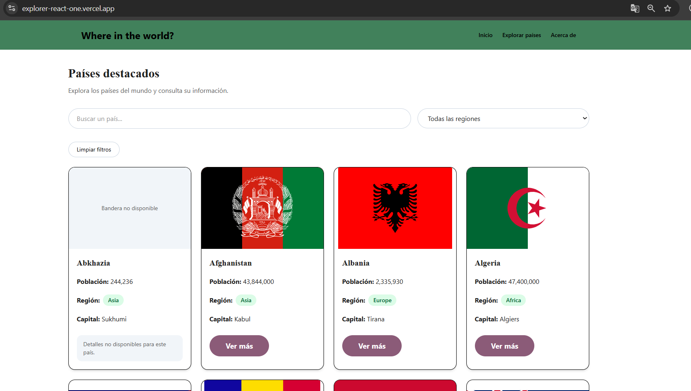
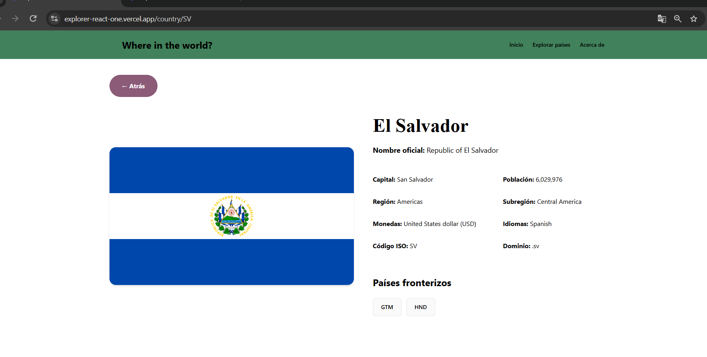
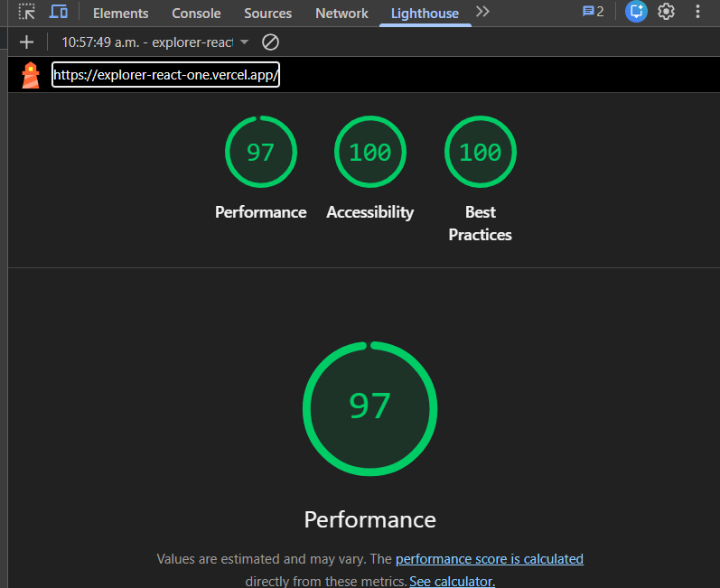

# Explorer App

Aplicación web desarrollada con React, TypeScript, Vite y Tailwind CSS v4. Permite explorar países, buscarlos por nombre, filtrarlos por continente y consultar información detallada mediante rutas dinámicas.

**Aplicación publicada:** [Explorer App en Vercel](https://explorer-react-one.vercel.app)

## Características

- Carga asíncrona de países desde REST Countries.
- Estados de carga, error, reintento y resultados vacíos.
- Búsqueda por nombre de país.
- Filtro por continente con etiquetas en español.
- Contador de países encontrados.
- Tarjetas con bandera, población, región y capital.
- Mensaje alternativo cuando una bandera o un detalle no está disponible.
- Página de detalle con capital, población, región, subregión, monedas, idiomas, dominio y fronteras.
- Navegación entre países fronterizos.
- Rutas con React Router:
  - `/` — listado de países.
  - `/country/:code` — detalle de un país.
  - Ruta no encontrada.
- Diseño adaptable para móvil y escritorio.

## Tecnologías

- React
- TypeScript
- Vite
- Tailwind CSS v4
- React Router v6
- REST Countries API
- Vercel Functions
- Vercel
- pnpm

## Requisitos

- Node.js 22 o superior.
- pnpm.
- Variable `REST_COUNTRIES_API_KEY` configurada en Vercel.

## Instalación y ejecución

```bash
git clone https://github.com/emeraul1/explorer-react.git
cd explorer-react
pnpm install
```

Para ejecutar el proyecto localmente con la función de API:

```bash
pnpm dlx vercel dev
```

Abre la dirección indicada por Vercel, normalmente:

```text
http://localhost:3000
```

> La clave de REST Countries se configura como variable de entorno en Vercel. No debe agregarse al repositorio.

## Comandos

```bash
pnpm build
```

Genera la compilación de producción.

```bash
pnpm lint
```

Analiza el código y detecta problemas de calidad.

```bash
pnpm dlx vercel --prod
```

Publica una versión de producción en Vercel.

## Estructura del proyecto

```text
explorer-react/
├── api/
│   └── countries.ts
├── public/
│   └── capturas/
│       ├── detail.png
│       └── home.png
├── src/
│   ├── api/
│   │   └── countries.ts
│   ├── components/
│   │   ├── atoms/
│   │   ├── molecules/
│   │   └── organisms/
│   ├── data/
│   │   └── country-codes.ts
│   ├── hooks/
│   │   ├── useCountries.ts
│   │   ├── useCountryDetail.ts
│   │   └── useSearch.ts
│   ├── pages/
│   │   ├── HomePage.tsx
│   │   ├── CountryDetailPage.tsx
│   │   └── NotFoundPage.tsx
│   ├── types/
│   ├── utils/
│   ├── App.tsx
│   └── main.tsx
├── package.json
└── vite.config.ts
```

## Organización del código

- **Atoms:** elementos pequeños como `Flag` y `Badge`.
- **Molecules:** componentes como `CountryCard`, `SearchBar` y `RegionFilter`.
- **Organisms:** componentes más completos como `CountryGrid`, `CountryDetail` y `SiteHeader`.
- **Custom Hooks:**
  - `useCountries()` obtiene el listado y controla carga, error y reintento.
  - `useSearch()` administra búsqueda, región y resultados filtrados.
  - `useCountryDetail()` obtiene el país según el código de la URL.
- **Pages:** representan las vistas principales de la aplicación.
- **API:** la función de Vercel protege la clave de REST Countries.

## Migración de Vanilla TypeScript a React

La versión Vanilla utilizaba manipulación directa del DOM, eventos manuales y hash routing. En esta versión:

- La interfaz se organizó en componentes reutilizables con props tipadas.
- El estado se administra con `useState`.
- La carga asíncrona usa `useEffect` y `AbortController`.
- La lógica se separó en custom hooks.
- La navegación se implementó con React Router y rutas dinámicas.
- La vista de detalle se obtiene mediante el parámetro `:code`.

Se reutilizaron los tipos de país y las utilidades de filtrado y formato. La lógica de consulta y navegación se adaptó a la arquitectura de React.

## Verificación

Antes de publicar se ejecutaron los siguientes comandos:

```bash
pnpm build
pnpm lint
```

La compilación se completó correctamente y el análisis no presentó errores ni advertencias.

## Capturas

### Listado de países



### Detalle de un país



## Medición inicial con Lighthouse

- **URL analizada:** https://explorer-react-one.vercel.app
- **Fecha:** 22 de noviembre de 2026.
- **Modo:** Mobile.

| Categoría | Puntaje |
|---|---:|
| Performance | 97 |
| Accessibility | 100 |
| Best Practices | 100 |



## Autor

Emerson Raúl Ventura Castillo

Proyecto académico de Diseño Web Adaptable.